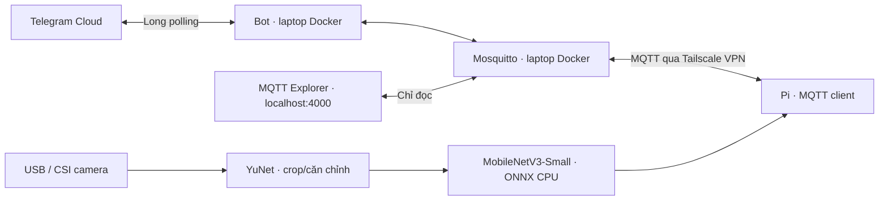

# EdgeFace

Nhận diện thành viên bằng MobileNetV3-Small fine-tune, chạy **ONNX trực tiếp trên Raspberry Pi 4**, điều khiển qua Telegram và MQTT. MQTT chỉ truyền metadata; khi bật gửi ảnh, bot tải một ảnh nhận diện có bounding box qua HTTP/Tailscale rồi gửi Telegram. Không dùng cloud inference.

Phiên bản 20/10/2026 đã train và triển khai 5 thành viên: Dung, Hùng, Nguyễn Hồ Trường Sơn, Thanh, Tuấn cùng lớp `Unknown`. Video do nhóm cung cấp, bổ sung 150 ảnh Sơn thu bằng camera Pi, Unknown lấy từ LFW công khai; training dùng GPU RTX 2050. Âm thanh tắt; thu thập camera qua MQTT đã chạy thực tế.

Release hiện tại `5010dc47644c` (ONNX `1e170d7902b8`) dùng classifier 6 lớp, fine-tune tiếp từ release team ban đầu với dữ liệu camera Sơn và replay dữ liệu cả nhóm. Đã sửa lỗi RGB/BGR khi USB camera đàm phán MJPEG; đạt 181/181 ảnh test, gồm 26 ảnh camera giữ lại, cùng quyết định ONNX trên laptop/Pi. **Các tập vẫn chung phiên quay, chưa là đánh giá độc lập theo phiên.** Bundle được cấu hình quản lý bằng Git LFS; dữ liệu mặt và checkpoint giữ cục bộ, release trước giữ để rollback.

- [Kiến trúc ngắn gọn cho team](docs/ARCHITECTURE.md)
- [Báo cáo tổng hợp cho team: kiến trúc, dữ liệu, mô hình và kết quả](report/PROJECT_HANDOFF.md)
- [Ảnh kiến trúc YuNet, MobileNetV3 và biểu đồ training loss — PNG/SVG](report/assets/figures/)
- [Tin nhắn và ảnh nhận diện có bounding box trên Telegram](docs/PHOTO_NOTIFICATIONS.md)
- [Benchmark PyTorch/ONNX trên cùng Pi: latency/FPS, Accuracy/Loss/F1, RAM/Flash](report/BENCHMARK_20261020.md)
- [Môi trường và trạng thái kiểm chứng](docs/ENVIRONMENT.md)
- [MQTT Explorer](docs/MQTT_EXPLORER.md)
- [Tailscale native và tự khởi động WSL/Pi](docs/TAILSCALE.md)
- [Quy tắc repository, file riêng và Git LFS](docs/REPOSITORY.md)

## Kiến trúc



## Phần cứng và phần mềm

Pi 4, camera USB hoặc CSI với driver phù hợp; laptop có Docker Compose, SSH, Python 3.10–3.12. GPU tùy chọn. ONNX Runtime 1.20.1 được kiểm chứng trên Pi Debian 12 **aarch64**, Python 3.11. Không chạy setup ARM64 trên Pi 32-bit; cần chọn wheel/build tương thích trước, không tự cài lại OS.

## Clone và Git LFS

```bash
git lfs install
git clone https://github.com/sonnguyen112/AIoT.git
cd AIoT/final
git lfs pull
```

Cài Git LFS trên máy trước khi clone. Nếu đã clone, chạy `git lfs install` và `git lfs pull`. Model ONNX phải là binary thật, không phải file pointer; cấu hình demo và dataset riêng không có trong repository.

## Setup laptop

```bash
python3 -m venv .venv
source .venv/bin/activate
python -m pip install -e '.[bot,edge,training,test]'
cp .env.example .env       # Chỉ làm khi chưa có .env
chmod 600 .env
```

Điền `TELEGRAM_BOT_TOKEN` trong `.env` cục bộ. `TELEGRAM_ALLOWED_USER_IDS` và `TELEGRAM_ALLOWED_CHAT_IDS` nhận ID số, cách nhau bằng dấu phẩy; để trống là chế độ mở theo lựa chọn MVP hiện tại. Không đưa token/password lên Git/chat. Với GPU, cài torch/torchvision theo [hướng dẫn PyTorch chính thức](https://pytorch.org/get-started/locally/) rồi kiểm tra `torch.cuda.is_available()`; training chọn CUDA tự động hoặc `--device cuda`.

```bash
python -m scripts.setup_mqtt
docker compose --profile bot --profile monitor up -d --build
python -m scripts.fetch_detector
```

Script tự tạo mật khẩu riêng cho bot, Pi, tài khoản monitor và UI; lưu ở `.env` quyền 600, broker chỉ nhận file mật khẩu đã hash. UI: **http://localhost:4000**, đăng nhập bằng `MQTT_EXPLORER_USERNAME/PASSWORD`; tự kết nối broker với `edgeface_monitor`. Không xuất `docker compose config` hoặc `docker inspect` toàn bộ ra log vì có thể chứa secrets.

## Kết nối và setup Pi

**Máy hiện tại đã dùng Tailscale native**, WSL `100.73.104.13`, Pi `100.83.132.53`. Pi đặt `MQTT_HOST=100.73.104.13`, broker giữ loopback và Tailscale Serve chuyển TCP 1883 trong tailnet vào broker. MQTT vẫn có password/ACL. Tailscale tự chạy trên cả hai máy; tác vụ Windows tự mở và giữ WSL khi đăng nhập. SSH tunnel cũ đã tắt. Xem [cài đặt, kiểm chứng và tự khởi động](docs/TAILSCALE.md).

Trước tiên kiểm tra OS, kiến trúc, RAM/storage, camera, SSH và Internet. Dùng SSH key; nếu cần password, nhập tương tác tại terminal:

```bash
ssh-copy-id pi@<PI_IP>
PI_HOST=pi@<PI_IP> bash scripts/deploy_pi.sh
python -m scripts.configure_pi --host pi@<PI_IP> --mqtt-host <WSL_TAILSCALE_IP>
tailscale serve --bg --tcp=1883 tcp://127.0.0.1:1883
```

Khi đổi Wi-Fi, địa chỉ Tailscale vẫn giữ nếu node/state hiện tại còn nguyên và hai máy có Internet. Dùng IP Tailscale Pi cho deployment; inference vẫn chạy cục bộ tại Pi. MQTT Explorer vẫn ở http://localhost:4000.

Đường kết nối MQTT hiện tại dùng Tailscale; các script SSH tunnel cũ đã được dọn khỏi repository. SSH vẫn dùng để quản trị và deploy Pi.

Chụp một frame kiểm tra **lưu tại Pi**:

```bash
ssh pi@<PI_IP> 'cd /home/pi/edgeface && .venv/bin/python -m raspberry_pi.camera'
```

Camera `auto` thử Picamera2/libcamera rồi V4L2; camera USB cũng có thể được libcamera hỗ trợ. Chọn `CAMERA_BACKEND=usb`, `CAMERA_INDEX` khi cần. Pi hiện tại dùng CyberTrack H7 và libcamera USB. Không mở camera khi agent idle.

Pi hiện dùng DHCP trên Wi-Fi; profile `edgeface-static` cũ đã tắt autoconnect để tránh giữ IP/gateway của mạng cũ. SSH qua Tailscale: `ssh pi@100.83.132.53`. Pi vẫn cần thông tin Wi-Fi và Internet của mạng đang dùng. Xem [môi trường](docs/ENVIRONMENT.md).

## Thu thêm ảnh trực tiếp từ Pi

Khi người đồng ý tham gia đứng trước camera, chạy trên laptop:

```bash
.venv/bin/python -m scripts.collect_member --name son --target 150 --timeout 300 --consent --stop-first
```

Script gửi command MQTT, đợi ACK/progress theo request ID và tự dừng khi đủ ảnh hoặc hết thời gian. Pi chạy YuNet, chỉ lưu frame có đúng một mặt đạt chất lượng, lọc ảnh gần trùng; ảnh nằm tại Pi `dataset/raw/<name>/<session>/`. Không tự gán nhãn bằng dự đoán model. Đồng bộ bằng `scripts/sync_dataset.sh` trước khi chuẩn bị dataset revision mới.

`training.import_camera_session <session_directory> --dataset <new_revision>` tạo các đoạn train/val/test có khoảng đệm, cùng source recording. `--swap-red-blue` chỉ dành cho ảnh legacy từ bug MJPEG trước bản sửa 20/10; **không dùng cho lần thu mới**. Ảnh gốc và SHA256 được giữ nguyên, ảnh dẫn xuất có provenance riêng.

## Chuẩn bị dữ liệu từ video

Đặt video: `dataset/videos/<name>/<session>.mp4`. Mỗi video phải thuộc người đồng ý tham gia; tránh nhiều người cùng frame. Tốt nhất **ít nhất 3 phiên độc lập mỗi thành viên** để chia tập theo phiên.

```bash
python -m training.import_video dataset/videos/<name>/<session>.mp4 --name '<name>' --consent
python -m training.fetch_unknown --identities 60 --per-identity 5
python -m training.dataset audit
python -m training.dataset split
```

Importer đọc metadata xoay của video MP4/MOV và đưa ảnh về đúng hướng trước khi chạy YuNet; crop có xoay theo mắt khi landmarks hợp lệ. Loại frame không/multiple faces, mặt nhỏ, mờ, quá tối/sáng, crop trùng lặp. Blur được đo trên ảnh tham chiếu 224×224 để không phụ thuộc độ phân giải video. Metadata lưu source, session, SHA256, hướng ảnh và thời gian trong video. Import lần nữa tạo phiên mới; không import lặp cùng video vào nhiều nhóm dữ liệu.

Chia các đoạn 0–50% / 60–75% / 85–100%; bỏ trống phần giữa. Đây là **đánh giá cùng phiên quay**, không thay thế test trên video mới. Unknown được chia theo danh tính, chưa xuất hiện trong train. LFW là dữ liệu web công khai có nguồn/checksum; không tuyên bố đã xác minh consent cho người trong LFW và không phân phối lại ảnh.

`processed/` đã có thì script từ chối ghi đè: lưu bản cũ sang thư mục riêng trước khi chia lại. `audit --delete-corrupt` chỉ xóa ảnh hỏng khi người dùng gọi rõ tùy chọn đó; mặc định chỉ báo cáo và loại khỏi split. Không commit dataset hoặc ảnh diagnostic.

## Training, calibration, đánh giá và ONNX

Dataset revision hiện tại là `dataset/revisions/team_20261020_son_live/processed`: 6 video của 5 thành viên, ảnh camera Sơn và Unknown từ 60 danh tính LFW. Dùng `--purged-temporal` khi import video, `--allow-multi-video-temporal` khi chia tập có temporal blocks; đây vẫn là test trên các phiên đã có dữ liệu train. Với ít nhất ba phiên độc lập, ưu tiên split theo phiên. Để train tiếp checkpoint có cùng class order/preprocessing, dùng `--init-checkpoint`, replay training data cũ và chọn output mới.

```bash
python -m training.train --data dataset/revisions/team_20261020_son_live/processed --output runs/<new_run> --init-checkpoint runs/team_20261020_son_live/best_model.pth --head-lr 0.0001 --fine-lr 0.00005 --device auto
```

Các lệnh bên dưới áp dụng cho một dataset đã chia tập. Dùng output mới cho từng lần train. Khi thêm class, tạo head mới từ ImageNet; không warm-start trực tiếp head hai lớp cũ. Run cả team đã thực hiện được ghi trong báo cáo ngày 20/10; benchmark camera dài hạn và đánh giá phiên độc lập vẫn cần bổ sung.

```bash
TORCH_HOME="$PWD/models/pretrained" python -m training.train --data dataset/revisions/team_20261020_son_live/processed --output runs/team --device auto --batch-size 16
python -m training.evaluate calibrate --data dataset/revisions/team_20261020_son_live/processed --checkpoint runs/team/best_model.pth --threshold runs/team/threshold.json
python -m training.evaluate test --data dataset/revisions/team_20261020_son_live/processed --checkpoint runs/team/best_model.pth --threshold runs/team/threshold.json --output runs/team/evaluation
python -m training.export_onnx --data dataset/revisions/team_20261020_son_live/processed --checkpoint runs/team/best_model.pth --threshold runs/team/threshold.json --output models/team
```

Head training đóng băng backbone; giai đoạn sau mở các block cuối, LR nhỏ hơn. Có class-weighted loss, augmentation vừa phải, seed, early stopping và checkpoint tốt nhất theo validation loss. Không dùng test để chọn threshold/hyperparameter. Preprocessing training và inference dùng chung RGB, PIL bilinear 224×224, ImageNet mean/std.

File xuất: `face_classifier.onnx`, `classes.json`, `preprocessing.json`, `threshold.json`, `export_validation.json`. Opset 17, batch cố định 1; checker và so sánh logits/decision trên cùng validation input. Unknown được quyết định bởi lớp Unknown và confidence threshold đã calibration.

Baseline là pretrained ImageNet backbone + head được train, backbone đóng băng (`best_head.pth`); model fine-tune là `best_model.pth`. Không dùng trực tiếp các nhãn ImageNet làm classifier danh tính. Để đánh giá baseline, calibration riêng với checkpoint tương ứng; không dùng threshold của model khác.

## Deploy model và service

Pi hỗ trợ `REJECTION_THRESHOLD` trong `.env` để đặt ngưỡng vận hành thủ công; cấu hình demo hiện dùng `0.9`. Confidence dưới 90% trả về Unknown, còn lớp Unknown luôn bị từ chối. Để trống biến này sẽ dùng ngưỡng đã chọn từ validation trong bundle. Khởi động lại dịch vụ `edgeface` sau khi đổi cấu hình. Ngưỡng vận hành không sửa `threshold.json` hay các số liệu đánh giá cũ; MQTT status có `rejection_threshold` và `rejection_threshold_source` để theo dõi.

```bash
python -m scripts.deploy_model --host pi@<PI_IP>
ssh pi@<PI_IP> 'cd /home/pi/edgeface && bash scripts/install_service.sh'
```

Bundle được upload vào release riêng, kiểm tra ONNX trên Pi rồi kích hoạt symlink `models/active`. Dùng `/stop` rồi `/start` để nạp cập nhật model. Service tự chạy sau reboot ở **idle**:

```bash
ssh pi@<PI_IP> 'sudo systemctl status edgeface --no-pager'
ssh pi@<PI_IP> 'sudo journalctl -u edgeface -n 30 --no-pager'
```

Broker/bot/Tailscale trên laptop phải hoạt động. Secrets Pi chỉ gồm credential MQTT thiết bị, không copy Telegram token. `setup_pi.sh` cài dependencies native trong venv, giữ hệ thống hiện có.

## Telegram demo

Gửi `/help` một lần để hiện nút **📷 Bắt đầu nhận diện** ở bàn phím Telegram. Bấm nút thay cho gõ `/start`; nút dùng cùng luồng MQTT, nhận kết quả và tự dừng. Bàn phím tiếp tục hiển thị để bắt đầu phiên tiếp theo; `/start` vẫn được hỗ trợ.

| Lệnh | Hành vi |
|---|---|
| `/start` | Pi mở camera, phát hiện/crop mặt và ONNX CPU inference |
| `/stop` | Dừng nhận diện, đóng camera |
| `/status` | Trạng thái thực tế, camera, model, CPU, RAM, nhiệt độ, latency |
| `/members` | Thành viên model và thành viên đã có dữ liệu camera |
| `/help` | Hướng dẫn |
| `/collect <name>` | Chức năng bổ sung: xác nhận consent rồi thu crop camera |
| `/collect_unknown <anonymous-id>` | Mỗi participant Unknown có ID ẩn danh riêng để split theo danh tính |

`/start` phản hồi **“Đang nhận diện...”**. Đứng một mình trước camera; khi nhận diện thành viên, bot gửi tên hiển thị và confidence/latency thật, tự gửi stop và chỉ báo camera đã dừng sau khi Pi xác nhận. **Unknown không gửi tin nhắn Telegram và vẫn tiếp tục nhận diện**; metadata Unknown vẫn có trong MQTT để quan sát/đánh giá. Lệnh tự stop gắn request ID phiên để không dừng nhầm phiên mới. Cooldown mặc định 30 giây mỗi nhãn MQTT trong phiên; `/start` mới reset cooldown để có phản hồi ngay. Nhiều mặt không tự gán nhãn; không có mặt sẽ thông báo sau thời gian cấu hình. Âm thanh tắt.

Tính năng ảnh đã bật cho demo: **tin nhắn kết quả và ảnh được gửi thành hai tin riêng**, về chat đã `/start`. Ảnh đúng frame nhận diện có bbox, tên hiển thị và confidence; Pi giữ RAM tạm 120 giây, HTTP chỉ bind Tailscale và yêu cầu token. Nếu ảnh lỗi, kết quả chữ và auto-stop vẫn hoạt động. Bật/tắt bằng `RECOGNITION_PHOTO_ENABLED` trên cả Pi/bot; provision secret bằng `scripts.configure_snapshots`. [Cấu hình và luồng chi tiết](docs/PHOTO_NOTIFICATIONS.md).

Tên hiển thị cấu hình tại `configs/display_names.json`: `son` → `Sơn`. Model/dataset dùng nhãn ổn định; Telegram dùng tên hiển thị. Đổi mapping không cần train lại. `AUTO_STOP_ON_KNOWN=true` bật hành vi tự dừng.

Collection đã được chạy thực tế với 150 crop Sơn từ camera Pi: target 150 mặc định, progress qua MQTT, timeout/stop và quality filtering. Các thành viên còn lại cần bổ sung phiên camera độc lập. Đồng bộ bằng `PI_HOST=pi@<PI_IP> bash scripts/sync_dataset.sh`.

## Benchmark và kiểm thử

```bash
python -m pytest
python -m scripts.mqtt_smoke
# Trên Pi, sau khi đồng bộ checkpoint/dữ liệu test riêng; dùng output mới:
.venv/bin/python -m training.benchmark_runtime suite --model models/releases/5010dc47644c --checkpoint reports/generated/benchmark_team_20261020/best_model.pth --data reports/generated/team_20261020_son_live_test --output reports/generated/<new_run> --threads 2 --warmup 30 --iterations 200 --rounds 3
```

Đã benchmark release hiện tại trên cùng Pi: PyTorch CPU **74,080 ms / 13,497 classifier FPS**; ONNX CPU **30,732 ms / 32,529 classifier FPS**. RSS peak inference **396,855 → 77,332 MiB**, model **5,931 → 5,823 MiB**, Accuracy **181/181**, macro F1 **1,000** ở cả hai runtime; có test loss, model/bundle/runtime storage và raw measurements trong [báo cáo benchmark](report/BENCHMARK_20261020.md). Đánh giá accuracy vẫn chia từ cùng phiên quay, không đại diện mọi điều kiện camera.

Suite dùng process riêng từng runtime để so RAM, 3 lượt × 200 inference, warmup 30; không cùng nạp hai runtime rồi suy ra RAM riêng lẻ. Benchmark pipeline bằng `training.benchmark_pipeline --mode replay` trên frame có sẵn cho **8,528 FPS**, không đo camera acquisition; không gọi đó là live camera FPS. Theo yêu cầu người dùng, đợt này không mở camera để benchmark. CPU process dùng đơn vị một core: Pi 4 có thể đạt 400%. Agent sampling/cooldown/auto-stop khiến throughput demo khác benchmark không throttle.

PyTorch CPU so với ONNX CPU phải cùng thiết bị/input/threads. Pi không cần PyTorch để chạy runtime; chỉ cài tùy chọn nếu muốn benchmark cùng Pi. Không so GPU laptop với CPU Pi rồi kết luận về ONNX.

## Troubleshooting

- **SSH hostname không resolve trên WSL:** dùng IP Pi, kiểm tra cùng Wi-Fi; host key mới được xác minh/pin, không tắt host-key verification.
- **MQTT offline:** kiểm tra `docker compose ps`, `tailscale status`, `tailscale serve status` trên WSL và mật khẩu đúng role. Command không retained, clean session, TTL và request ID SQLite chống thực thi lại sau reconnect/restart. Device LWT báo offline.
- **Bot không phản hồi:** kiểm tra token, hai allowlist nếu bật, health backend, chỉ một bot long-polling chạy cùng token. Exception logs không in token.
- **Camera bận:** `/stop`, kiểm tra có chương trình khác giữ `/dev/video0` không. Không chạy benchmark camera song song agent recognizing.
- **Camera/model error:** `/status` phân biệt lỗi camera/detector/model; Unknown là dự đoán, không phải lỗi vận hành. Stop hoặc lỗi đều đóng camera.
- **Collection ít ảnh:** thay đổi góc/ánh sáng; duplicate và blur filter có thể loại nhiều ảnh. Không bỏ kiểm tra nhiều mặt để tăng count.
- **GPU trong sandbox báo unavailable:** CUDA đã kiểm chứng ngoài sandbox. Chạy training tại terminal có quyền GPU; nếu GPU unavailable, dùng CPU.

## Dữ liệu và giới hạn

Dataset, checkpoint và config private được gitignore; bundle ONNX đang deploy được chia sẻ bằng LFS; dataset/file quyền 700/600. Camera probe/benchmark crop chứa ảnh thật và chỉ lưu local. `python -m scripts.delete_member <name>` là dry-run; thêm `--confirm-name <name>` mới xóa dữ liệu local. Sau đó retrain model để loại thông tin từ trọng số; xóa cả bản đồng bộ trên laptop/Pi và backups theo chính sách nhóm. Không dùng hệ thống làm kiểm soát truy cập có độ tin cậy cao: **chưa có liveness detection**, ảnh in/màn hình có thể đánh lừa classifier.

Model đang chia sẻ phân loại 5 thành viên và Unknown. Train/test vẫn chung nguồn quay nên chưa chứng minh khả năng tổng quát ở phiên mới. Cần bổ sung các phiên độc lập cho cả team, train lại và đánh giá trên Pi. Chưa có liveness detection hoặc đánh giá live-camera đầy đủ có ground truth.

Nguồn: [YuNet/OpenCV](https://docs.opencv.org/4.12.0/d0/dd4/tutorial_dnn_face.html), [MobileNetV3-Small](https://docs.pytorch.org/vision/stable/models/generated/torchvision.models.mobilenet_v3_small.html), [ONNX Runtime Python ARM64](https://onnxruntime.ai/docs/get-started/with-python.html), [LFW research paper](https://people.cs.umass.edu/~elm/papers/lfw.pdf), [LFW loader/checksum](https://github.com/scikit-learn/scikit-learn/blob/main/sklearn/datasets/_lfw.py).
